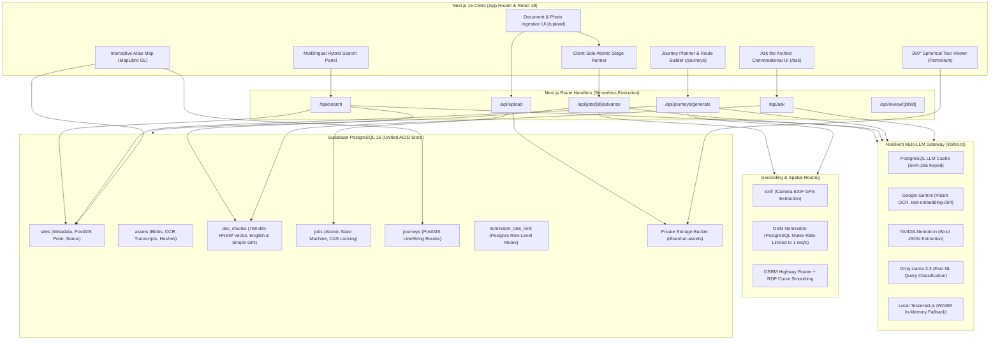
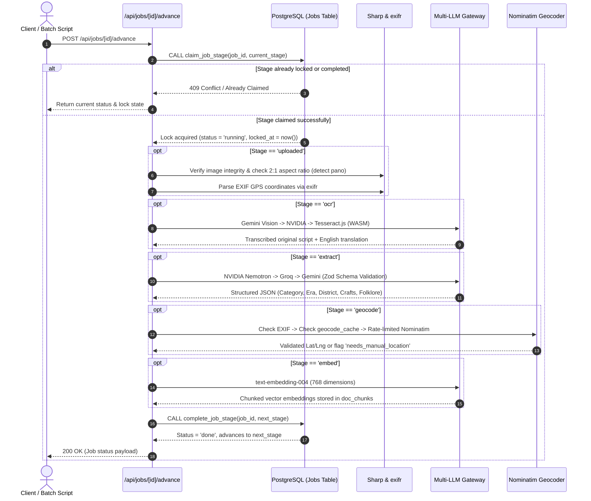
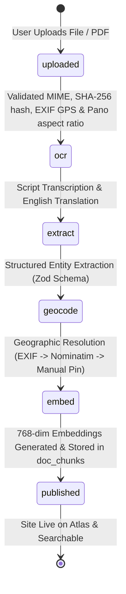
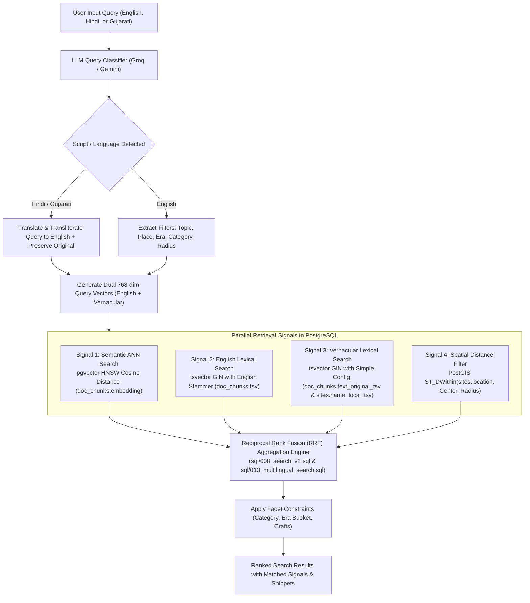
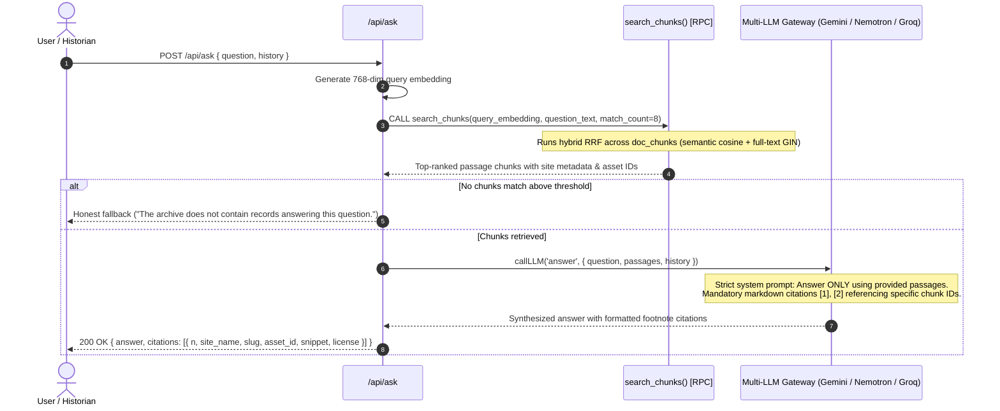
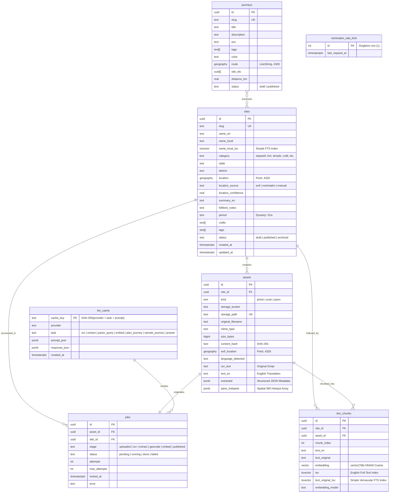

# Dharohar · धरोहर
### Digital Revitalisation of Unstructured Cultural & Architectural Heritage Archives

[](https://nextjs.org/)
[](https://react.dev/)
[](https://www.typescriptlang.org/)
[](https://supabase.com/)
[](https://maplibre.org/)
[](https://tailwindcss.com/)
[](LICENSE)

---

## 1. Executive Summary & Problem Context

Centuries of Indian architectural, epigraphic, and artisan traditions survive as **fragmented, unstructured, and non-digitised records**:

* **Heterogeneous Physical Records**: Fading palm-leaf manuscripts, paper farmans, estampages (epigraphic stone/copper rubbings), 19th-century colonial surveys, and field photographs.
* **Linguistic & Epigraphic Isolation**: Crucial inscriptions and vernacular documentation written in regional scripts (Devanagari, Old Gujarati, Sharada, Persian, Modi, and regional dialects) remain unindexed, untranslated, and inaccessible to modern researchers and cultural travelers.
* **Geospatial Disconnect**: Archival records rarely link to validated spatial coordinates or thematic itineraries, leaving subterranean stepwells (*vavs*), rock-cut shrines, medieval forts, and artisan clusters hidden from geographic discovery.
* **Infrastructure Cost Barriers**: Heritage institutions and non-profit trusts lack budgets for dedicated GPU clusters, complex queue runners (Celery/BullMQ), or expensive commercial enterprise AI platforms.

**Dharohar** (*"Heritage"* in Hindi) is a full-stack, workerless, serverless platform that ingests unstructured heritage scans and photographs, runs them through an automated multi-stage pipeline, and revitalises them into an interactive digital atlas with cross-lingual semantic search, immersive 360° virtual tours, grounded RAG conversational archives, and AI-powered journey planning.

---

## 2. Key Capabilities

| Capability | Description | Core Technologies |
| :--- | :--- | :--- |
| **Workerless Ingestion Pipeline** | 6-stage asynchronous pipeline running directly on serverless Next.js edge/node functions using an atomic Postgres state machine. No persistent background workers or Redis required. | Postgres Compare-and-Swap, Node.js Streams, Sharp, EXIFR |
| **Multi-Provider LLM Gateway** | Resilient multi-model orchestration with automatic failover, exponential backoff, circuit breaking, and response caching for OCR, extraction, search parsing, and RAG. | Google Gemini, NVIDIA Nemotron, Groq (Llama 3.3), Tesseract.js WASM |
| **Multilingual Hybrid Search** | Blends dense semantic vector retrieval (`pgvector` cosine similarity) with lexical keyword matching (`tsvector` GIN) and spatial filtering (`PostGIS`) via Reciprocal Rank Fusion (RRF). Translates Devanagari & Gujarati queries on the fly. | `pgvector` HNSW, PostgreSQL FTS (`english` & `simple`), PostGIS `ST_DWithin` |
| **Interactive Heritage Atlas** | Vector-tile interactive map rendering sites, curated historical journeys, and live custom route builders with zero proprietary tile API costs. | MapLibre GL JS, OpenFreeMap Liberty tiles |
| **360° Equirectangular Tours** | Immersive WebGL spherical panoramas with interactive spatial hotspot annotations linking to historical documents and audio/photo notes. | Pannellum HTML5 WebGL, Canvas fallback |
| **"Plan a Journey" AI Engine** | Natural language itinerary generator that parses user constraints, resolves spatial waypoints, fetches candidate monuments, calculates highway routes via OSRM with Ramer-Douglas-Peucker simplification, and generates historical narratives. | OSRM Highway Engine, RDP Simplification, Gemini / Nemotron |
| **"Ask the Archive" Grounded RAG** | Conversational archive assistant answering questions strictly grounded in indexed historical document chunks, complete with transparent passage citations and deep-links to source pages. | Vector ANN, PostgreSQL GIN Search, RRF, Strict Citation Engine |

---

## 3. High-Level System Architecture



---

## 4. Architectural Workflows & Flowcharts

### 4.1. Workerless Asynchronous Ingestion Pipeline

Instead of maintaining a continuous daemon process, Dharohar leverages **client-driven or script-driven stage advancement** coupled with an atomic Compare-And-Swap (CAS) locking mechanism in PostgreSQL (`claim_job_stage`, `complete_job_stage`, `fail_job_stage`).



#### Detailed Pipeline Stages:



1. **`uploaded`**: Computes SHA-256 digest for deduplication. Inspects image dimensions via `sharp` to detect 2:1 equirectangular aspect ratio (tagging asset as `kind='pano'`). Extracts EXIF GPS metadata via `exifr`.
2. **`ocr`**: Transcribes Devanagari, Hindi, Gujarati, or English. Returns both original script (`text_original`) and high-fidelity English translation (`text_en`). Employs local in-process Tesseract.js WASM if cloud providers are degraded.
3. **`extract`**: Runs structured entity recognition adhering to a strict Zod schema. Extracts site name, category, historical period, state, district, artisan crafts, folklore notes, and confidence scores.
4. **`geocode`**: Prioritizes EXIF GPS; if missing, issues a rate-limited query to OpenStreetMap Nominatim using a PostgreSQL advisory lock (max 1 req/s). If unresolved, flags `needs_manual_location = true`.
5. **`embed`**: Partitions translated documentation into overlapping semantic passages, generates 768-dimensional dense vectors using Google `text-embedding-004`, and updates `doc_chunks`.
6. **`published`**: Promotes site status to `published`, compiles bounding boxes, and activates discovery on the Atlas map.

---

### 4.2. Multilingual Hybrid Search & Reciprocal Rank Fusion (RRF)

Dharohar solves the cross-lingual vocabulary mismatch problem by executing parallel lexical and semantic pipelines, then merging candidate ranks with Reciprocal Rank Fusion:

$$\text{RRF Score}(d) = \sum_{m \in M} \frac{w_m}{k + \text{rank}_m(d)}$$

Where $k \approx 60$, and $w_m$ represents the signal weight (Semantic ANN, English Keyword FTS, Original Script Simple FTS, and Spatial Proximity).



---

### 4.3. "Plan a Journey" AI Route Generator

The Journey Planner transforms an open-ended conversational request (e.g. *"A 3-day stepwell trail starting from Ahmedabad exploring Solanki architecture"*) into an optimized, drivable travel itinerary:

```mermaid
flowchart TD
    Prompt["User NL Prompt (e.g., '3-day Solanki stepwells from Ahmedabad')"] --> LLMPlan["LLM Itinerary Parser (Gemini / Nemotron)"]
    
    LLMPlan --> Constraints["Extracted Constraints:<br/>- Origin City<br/>- Duration (Days)<br/>- Thematic Categories<br/>- Target Era / Dynasty"]
    
    Constraints --> OriginGeocode["Geocode Starting Point (Ahmedabad -> Lat/Lng)"]
    OriginGeocode --> DBQuery["Query Supabase for Matching Sites within Spatial Radius"]
    
    DBQuery --> CandidateSites["Candidate Heritage Sites with GPS Coordinates"]
    
    CandidateSites --> Clustering["Cluster & Order Stops:<br/>1. Group sites into geographic day clusters<br/>2. Greedy nearest-neighbor TSP within days"]
    
    Clustering --> RoadRouting["Road Routing Engine (lib/road-routing.ts):<br/>1. Fetch road corridor geometry from OSRM<br/>2. Apply Ramer-Douglas-Peucker (epsilon ≈ 500m) smoothing<br/>3. Fallback to Haversine geodesics on timeout"]
    
    RoadRouting --> StopContext["Compile Context for Each Stop (Name, Era, Crafts, Summary)"]
    StopContext --> LLMNarrate["LLM Journey Narrator (callLLM: 'narrate_journey')"]
    
    LLMNarrate --> Response["Structured Journey Output:<br/>- Historical Narrative Title & Intro<br/>- Day-by-Day Sequenced Stops with Blurbs<br/>- Clean Road-Snapped GeoJSON LineString<br/>- Total Highway Distance (km)"]
    
    Response --> InteractiveMap["Render Numbered Pins & Highway Line on MapLibre Canvas"]
```



---

### 4.4. "Ask the Archive" Grounded RAG Architecture

The archival assistant provides factual answers without hallucination by grounding responses exclusively in indexed archival document chunks:



---

## 5. Database Architecture & Entity Relationships

The relational data model is constructed on PostgreSQL 15 with `postgis` and `pgvector` extensions enabled:



---

## 6. Technology Stack & Design Decisions

| Subsystem | Technology | Rationale & Alternatives Considered |
| :--- | :--- | :--- |
| **Full-Stack Framework** | **Next.js 16 (App Router, Turbopack)** | Server Components ensure zero-bundle hydration overhead for content pages. Route Handlers provide stateless execution for pipeline stages without needing separate Express/FastAPI backends. |
| **Database & Vector Engine** | **Supabase (PostgreSQL 15 + PostGIS + pgvector)** | Colocating relational metadata, spatial primitives (`geography(Point, 4326)` and `geography(LineString, 4326)`), and vector embeddings (`vector(768)`) eliminates the latency and dual-write inconsistencies of external vector DBs (e.g., Pinecone/Milvus). |
| **Vector Indexing** | **HNSW (`vector_cosine_ops`)** | Hierarchical Navigable Small World graphs provide sub-50ms approximate nearest neighbor queries at $O(\log N)$ scalability compared to IVFFlat or brute-force scans. |
| **Interactive Maps** | **MapLibre GL JS (v6.16)** | Completely open-source, fork-free WebGL vector map rendering without Mapbox licensing fees or token metering. Paired with OpenFreeMap vector tile endpoints. |
| **360° Panorama Viewer** | **Pannellum + WebGL Canvas Fallback** | Ultra-lightweight (~25KB) equirectangular projection viewer with hotspot coordinates, eliminating the massive runtime overhead of Three.js. |
| **Multi-LLM Gateway** | **Gemini + NVIDIA Nemotron + Groq + Tesseract.js** | Eliminates single-vendor dependencies. **Groq** processes sub-second query classifications; **NVIDIA Nemotron** generates schema-validated JSON extractions; **Gemini** handles multimodal OCR and 768-dim embeddings; **Tesseract.js WASM** acts as an offline emergency fallback. |
| **Image & Spatial Processing** | **Sharp + exifr** | High-speed C++ libvips image inspection in Node.js to compute image hashes, dimensions, and camera EXIF GPS without external microservices. |
| **Road Routing & Highway Snapping** | **OSRM + Ramer-Douglas-Peucker** | Highway routing via OSRM smoothed with RDP ($\epsilon \approx 0.005^\circ \approx 550\text{ m}$) strips distracting residential turns, generating clean, elegant heritage corridors. |

---

## 7. Migration Roadmap & SQL Schema Reference

Dharohar maintains an incremental database migration pipeline in [`sql/`](file:///Users/indrayadav/Desktop/iitgandhi/dharohar/sql/):

| Script | Purpose |
| :--- | :--- |
| [`000_health.sql`](file:///Users/indrayadav/Desktop/iitgandhi/dharohar/sql/000_health.sql) | Baseline environment validation and extension verification. |
| [`001_schema.sql`](file:///Users/indrayadav/Desktop/iitgandhi/dharohar/sql/001_schema.sql) | Enables `postgis` & `pgvector`. Defines `sites`, `assets`, `doc_chunks`, `jobs`, RLS policies, and HNSW indexes. |
| [`001_seed_sites.sql`](file:///Users/indrayadav/Desktop/iitgandhi/dharohar/sql/001_seed_sites.sql) | Curated seed dataset covering prominent Western Indian stepwells and temple complexes. |
| [`001b_upload_fields.sql`](file:///Users/indrayadav/Desktop/iitgandhi/dharohar/sql/001b_upload_fields.sql) | Schema additions for multi-asset upload support, mime types, and file checksums. |
| [`002_search_fn.sql`](file:///Users/indrayadav/Desktop/iitgandhi/dharohar/sql/002_search_fn.sql) | Initial hybrid search stored procedure combining cosine distance and keyword matching. |
| [`003_llm_cache.sql`](file:///Users/indrayadav/Desktop/iitgandhi/dharohar/sql/003_llm_cache.sql) | Content-addressed SHA-256 caching layer for all LLM prompts, embeddings, and completions. |
| [`004_ocr_fields.sql`](file:///Users/indrayadav/Desktop/iitgandhi/dharohar/sql/004_ocr_fields.sql) | Columns for original transcription (`ocr_text`), English translation (`text_en`), and language detection. |
| [`005_extract_fields.sql`](file:///Users/indrayadav/Desktop/iitgandhi/dharohar/sql/005_extract_fields.sql) | Structured JSON storage for extracted entities, folklore, crafts, and confidence metrics. |
| [`006_geocode_fields.sql`](file:///Users/indrayadav/Desktop/iitgandhi/dharohar/sql/006_geocode_fields.sql) | Geocoding cache table and manual location verification flags. |
| [`007_nominatim_rate_limit.sql`](file:///Users/indrayadav/Desktop/iitgandhi/dharohar/sql/007_nominatim_rate_limit.sql) | Enforces strict 1 req/sec rate-limiting mutex for OpenStreetMap Nominatim compliance. |
| [`008_search_v2.sql`](file:///Users/indrayadav/Desktop/iitgandhi/dharohar/sql/008_search_v2.sql) | Enhanced hybrid Reciprocal Rank Fusion search function with facet filtering and spatial radii. |
| [`009_review_fields.sql`](file:///Users/indrayadav/Desktop/iitgandhi/dharohar/sql/009_review_fields.sql) | Human-in-the-loop review schemas and verification flags. |
| [`010_phase5_pano_journeys.sql`](file:///Users/indrayadav/Desktop/iitgandhi/dharohar/sql/010_phase5_pano_journeys.sql) | Adds 360° panorama hotspot support, `journeys` table with GeoJSON LineStrings, and spatial views. |
| [`011_journey_planner.sql`](file:///Users/indrayadav/Desktop/iitgandhi/dharohar/sql/011_journey_planner.sql) | Registers `plan_journey` and `narrate_journey` operations in the LLM caching constraints. |
| [`012_ask_archive.sql`](file:///Users/indrayadav/Desktop/iitgandhi/dharohar/sql/012_ask_archive.sql) | `search_chunks()` RPC for chunk-level hybrid RRF search powering the Grounded RAG system. |
| [`013_multilingual_search.sql`](file:///Users/indrayadav/Desktop/iitgandhi/dharohar/sql/013_multilingual_search.sql) | Vernacular text search support: adds `name_local_tsv` and `text_original_tsv` with `simple` dictionary index. |

---

## 8. API Specification

### 8.1. Document & Photo Ingestion

#### `POST /api/upload`
Initiates a single or multi-file archival asset ingestion.

* **Request**: `multipart/form-data`
  * `file`: Binary file (`image/jpeg`, `image/png`, `image/webp`, or `application/pdf`, $\le 10\text{ MB}$).
  * `title`: Optional working title.
  * `notes`: Optional archivist notes.
  * `site_id`: Optional UUID if attaching asset to an existing heritage site.
* **Response** `200 OK`:
  ```json
  {
    "job_id": "8a3297ee-b732-4752-9dae-fd072e50529e",
    "asset_id": "44320958-868e-4a67-9d7a-72ef4dcab129",
    "site_id": "d05776d6-f831-4c13-a447-bc09c6934c9f",
    "status": "pending",
    "stage": "uploaded"
  }
  ```

---

#### `POST /api/jobs/[id]/advance`
Executes exactly **one atomic stage** of the ingestion pipeline. Called sequentially by the client poller or batch worker.

* **Parameters**: `id` (Job UUID).
* **Response** `200 OK`:
  ```json
  {
    "job_id": "8a3297ee-b732-4752-9dae-fd072e50529e",
    "previous_stage": "ocr",
    "current_stage": "extract",
    "status": "done",
    "progress_percent": 40,
    "asset": {
      "language_detected": "hi",
      "text_en": "Subterranean stepwell built in 1063 AD by Queen Udayamati..."
    }
  }
  ```

---

### 8.2. Multilingual Hybrid Search

#### `GET /api/search`
Executes cross-lingual RRF search across published monuments and archival chunks.

* **Query Parameters**:
  * `q` (string, required): Natural language query in English, Hindi, or Gujarati.
  * `type` (string[], optional): Multi-select category filter (`stepwell`, `fort`, `temple`, etc.).
  * `era` (string[], optional): Era bucket (`Ancient`, `Solanki`, `Mughal`, `Colonial`, etc.).
  * `craft` (string[], optional): Artisan crafts (`stone carving`, `patola weaving`, etc.).
* **Example Request**:
  ```bash
  curl "http://localhost:3000/api/search?q=%E0%AA%AA%E0%AA%BE%E0%AA%9F%E0%AA%A3%E0%AA%A8%E0%AB%80%20%E0%AA%B5%E0%AA%BE%E0%AA%B5&type=stepwell"
  ```
* **Response** `200 OK`:
  ```json
  {
    "query": "પાટણની વાવ",
    "parsed": {
      "language": "gu",
      "topic": "stepwells in Patan",
      "topic_en": "Patan stepwells",
      "topic_original": "પાટણની વાવ",
      "place": "Patan",
      "radius_km": 50,
      "type": "stepwell"
    },
    "total": 1,
    "results": [
      {
        "site_id": "d05776d6-f831-4c13-a447-bc09c6934c9f",
        "slug": "rani-ki-vav",
        "name": "Rani ki Vav (Queen's Stepwell)",
        "name_local": "રાણકી વાવ",
        "type": "stepwell",
        "era": "11th century (Solanki dynasty)",
        "state": "Gujarat",
        "district": "Patan",
        "lat": 23.8589,
        "lng": 72.1016,
        "semantic_sim": 0.892,
        "score": 0.0321,
        "matched_signals": ["vernacular_kw", "semantic_vector", "spatial_proximity"],
        "snippet": "Monumental inverted temple stepwell built on the banks of the Saraswati river..."
      }
    ]
  }
  ```

---

### 8.3. "Plan a Journey" Itinerary Generator

#### `POST /api/journeys/generate`
Generates a multi-day heritage travel itinerary based on natural language instructions.

* **Request Body**:
  ```json
  {
    "prompt": "Plan a 2-day architectural journey from Ahmedabad exploring Solanki stepwells and Sun temples"
  }
  ```
* **Response** `200 OK`:
  ```json
  {
    "ok": true,
    "title": "Solanki Architectural Masterpieces: Subterranean Waters & Solar Sanctums",
    "intro": "Traverse the heart of northern Gujarat following the 11th-century architectural patronage of the Solanki rulers...",
    "total_km": 242.4,
    "days": [
      {
        "day": 1,
        "stops": [
          {
            "site_id": "...",
            "name": "Adalaj Stepwell",
            "lat": 23.1667,
            "lng": 72.5833,
            "leg_km": 18.5,
            "blurb": "Begin your journey at this five-story subterranean pavilion featuring intricate Indo-Islamic floral carvings."
          }
        ]
      }
    ],
    "route_geojson": {
      "type": "LineString",
      "coordinates": [[72.5714, 23.0225], [72.5833, 23.1667]]
    }
  }
  ```

---

### 8.4. "Ask the Archive" Grounded RAG

#### `POST /api/ask`
Answers user questions strictly grounded in archival document passages with transparent source citations.

* **Request Body**:
  ```json
  {
    "question": "What deities are carved into the subterranean levels of Rani ki Vav?",
    "history": []
  }
  ```
* **Response** `200 OK`:
  ```json
  {
    "ok": true,
    "answer": "Rani ki Vav is designed as an inverted temple honoring sacred water. The lower subterranean tiers feature over five hundred principal sculptures, predominantly representing the avatars of Lord Vishnu [1], including Sheshashayi Vishnu reclining on the thousand-headed serpent Shesha [2].",
    "citations": [
      {
        "n": 1,
        "chunk_id": "764ef1a2-...",
        "site_name": "Rani ki Vav",
        "slug": "rani-ki-vav",
        "snippet": "...over 500 major sculptures and over a thousand minor ones that combine religious, mythological and secular imagery...",
        "licence": "Public Domain Mark 1.0"
      }
    ]
  }
  ```

---

## 9. Local Installation & Development Setup

### 9.1. Prerequisites
* **Node.js**: `v20.6.0` or higher (Node 20+ required for native `--env-file` support).
* **Package Manager**: `npm` (v10+).
* **Supabase Project**: Free tier at [supabase.com](https://supabase.com).

---

### 9.2. Installation

1. **Clone the Repository**:
   ```bash
   git clone https://github.com/your-username/dharohar.git
   cd dharohar
   ```

2. **Install Dependencies**:
   ```bash
   npm install
   ```
   *(Note: The `postinstall` script automatically extracts `maplibre-gl-worker.mjs`, `maplibre-gl-shared.mjs`, and CSS directly to `public/`)*.

---

### 9.3. Supabase Database Configuration

1. In the Supabase Dashboard, navigate to the **SQL Editor**.
2. Run the migration scripts in sequential order from the [`sql/`](file:///Users/indrayadav/Desktop/iitgandhi/dharohar/sql/) folder:
   - `000_health.sql`
   - `001_schema.sql`
   - `001_seed_sites.sql`
   - `001b_upload_fields.sql`
   - `002_search_fn.sql`
   - `003_llm_cache.sql`
   - `004_ocr_fields.sql`
   - `005_extract_fields.sql`
   - `006_geocode_fields.sql`
   - `007_nominatim_rate_limit.sql`
   - `008_search_v2.sql`
   - `009_review_fields.sql`
   - `010_phase5_pano_journeys.sql`
   - `011_journey_planner.sql`
   - `012_ask_archive.sql`
   - `013_multilingual_search.sql`
3. In your Supabase Dashboard under **Storage**, create a **Private Bucket** named `dharohar-assets`.

---

### 9.4. Environment Variables Configuration

Copy `.env.example` to `.env.local`:
```bash
cp .env.example .env.local
```

Configure your environment keys:

```ini
# ==============================================================================
# Supabase Configuration
# ==============================================================================
NEXT_PUBLIC_SUPABASE_URL=https://YOUR_PROJECT_ID.supabase.co
NEXT_PUBLIC_SUPABASE_ANON_KEY=eyJhbGciOiJIUzI1NiIsInR5cCI...
SUPABASE_SERVICE_ROLE_KEY=eyJhbGciOiJIUzI1NiIsInR5cCI...
SUPABASE_STORAGE_BUCKET=dharohar-assets

# ==============================================================================
# Multi-LLM Provider Credentials (Free Tiers Supported)
# ==============================================================================
# Google AI Studio: https://aistudio.google.com/
GEMINI_API_KEY=AIzaSy...
GEMINI_MODEL_OCR=gemini-1.5-flash
GEMINI_MODEL_EMBED=text-embedding-004

# NVIDIA NGC Build: https://build.nvidia.com/
NVIDIA_API_KEY=nvapi-...
NVIDIA_BASE_URL=https://integrate.api.nvidia.com/v1
NVIDIA_MODEL_EXTRACT=nvidia/nemotron-4-340b-instruct

# Groq Console: https://console.groq.com/
GROQ_API_KEY=gsk_...
GROQ_BASE_URL=https://api.groq.com/openai/v1
GROQ_MODEL_QUERY_PARSE=llama-3.3-70b-versatile

# Routing Chains (Order of automatic failover)
LLM_CHAIN_OCR=gemini,nvidia,groq
LLM_CHAIN_EXTRACT=nvidia,groq,gemini
LLM_CHAIN_QUERY_PARSE=groq,nvidia,gemini

# ==============================================================================
# Geocoding & Mapping Services
# ==============================================================================
NOMINATIM_USER_AGENT=Dharohar-Revitalisation/1.0 (heritage-contact@yourdomain.edu)
NEXT_PUBLIC_MAP_STYLE_URL=https://tiles.openfreemap.org/styles/liberty
```

---

### 9.5. Starting the Development Server

```bash
npm run dev
```

Visit [http://localhost:3000](http://localhost:3000) to explore the application.

---

## 10. Batch Processing & Archival Ingestion Tools

Dharohar provides automated CLI utilities for offline processing of large collections:

```bash
# Preview metadata and simulate pipeline execution without writing to DB
npm run seed -- --dir=seed/samples --csv=seed/metadata.csv --dry-run

# Run batch ingestion with 2.5s throttling to honor free-tier API limits
npm run seed -- --dir=seed/samples --csv=seed/metadata.csv --throttle-ms=2500

# Re-embed all indexed document chunks with updated embedding models
npm run reembed

# Fetch open-access heritage imagery from Wikimedia Commons
npx tsx scripts/fetch-commons.ts
```

---

## 11. Security, Compliance & System Guarantees

* **Atomic Job Concurrency**: Using PostgreSQL compare-and-swap stage claiming (`claim_job_stage`), multiple client pollers or edge workers can advance the pipeline without race conditions or duplicated LLM charges.
* **Storage Protection**: Archival scans and high-resolution photography reside in private buckets. Access is granted solely through server-generated HMAC-signed URLs with a 1-hour expiration time.
* **Nominatim Fair Use Compliance**: OpenStreetMap limits Nominatim usage to 1 request per second. Dharohar enforces this at the database level via a PostgreSQL singleton row lock (`sql/007_nominatim_rate_limit.sql`), eliminating IP rate-limit bans across distributed serverless invocations.
* **HNSW Sub-50ms Indexing**: Vectors are indexed with `hnsw (embedding vector_cosine_ops)`. Nearest-neighbor queries execute in under 50ms across tens of thousands of chunks without table scans.
* **Prompt Injection Defense**: Archival RAG queries enforce system-level prompt sandboxing, preventing prompt injections from hijacking citations or revealing system instructions.

---

## 12. Ethical Cultural Archiving & Open Data Standards

Archival contributors and institutional partners must adhere to open-heritage protocols:

### Sourcing & Ethics Checklist
- [x] **Public Domain / Creative Commons**: Confirm items are marked Public Domain Mark (PDM 1.0), CC0 1.0 Universal, or CC-BY 4.0.
- [x] **Cultural & Sacred Sensitivity**: Do not digitise or publish secret tribal rituals, restricted inner-sanctum deities (*garbhagriha*), or unreleased private devotional records.
- [x] **Attribution Integrity**: Maintain source provenance including accession numbers, institutional call numbers, and photographer credits.

### Recommended Open Heritage Repositories
1. **Archaeological Survey of India (ASI) / Epigraphia Indica**: Inscriptions and rubbings on [archive.org](https://archive.org/).
2. **National Mission on Manuscripts (NMM) / IGNCA**: Palm-leaf manuscripts in Devanagari, Sharada, and Grantha.
3. **Wikimedia Commons Heritage Surveys**: High-resolution equirectangular 360° panoramas and architectural drawings under CC-BY-SA.
4. **Metropolitan Museum of Art Open Access (CC0)**: 19th-century photographic surveys of Indian monuments.
5. **British Library Endangered Archives Programme (EAP)**: Regional vernacular records and mercantile ledgers.

---

## 13. License

Distributed under the **MIT License**. See [LICENSE](LICENSE) for more information.
Copyright © 2026 Dharohar Project Contributors.
